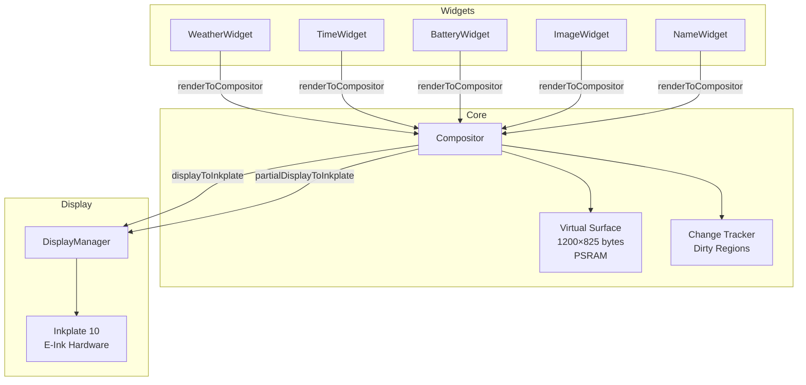
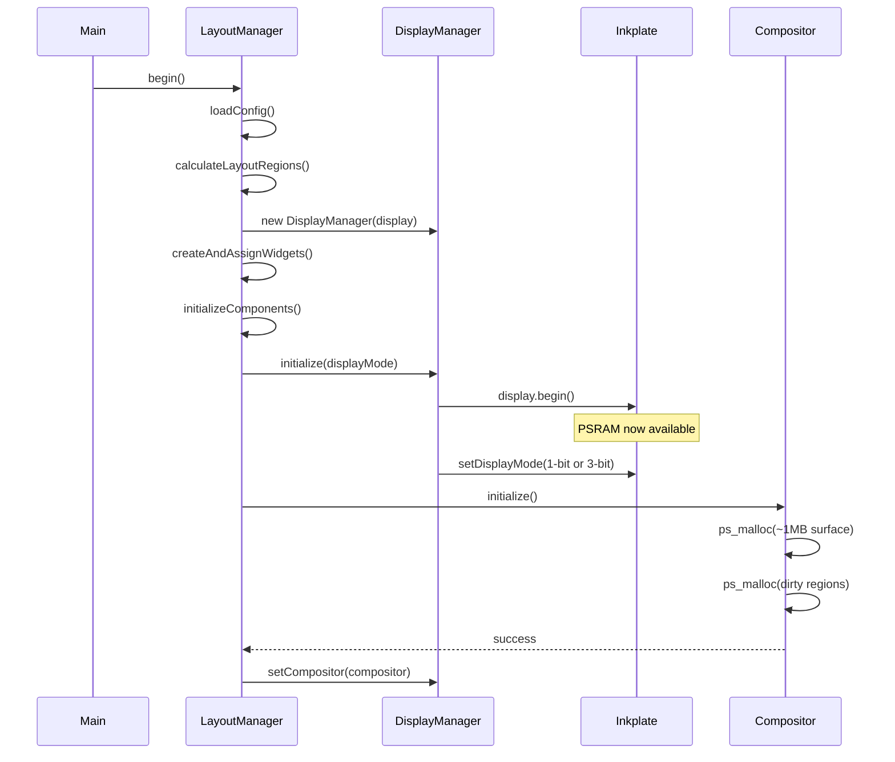
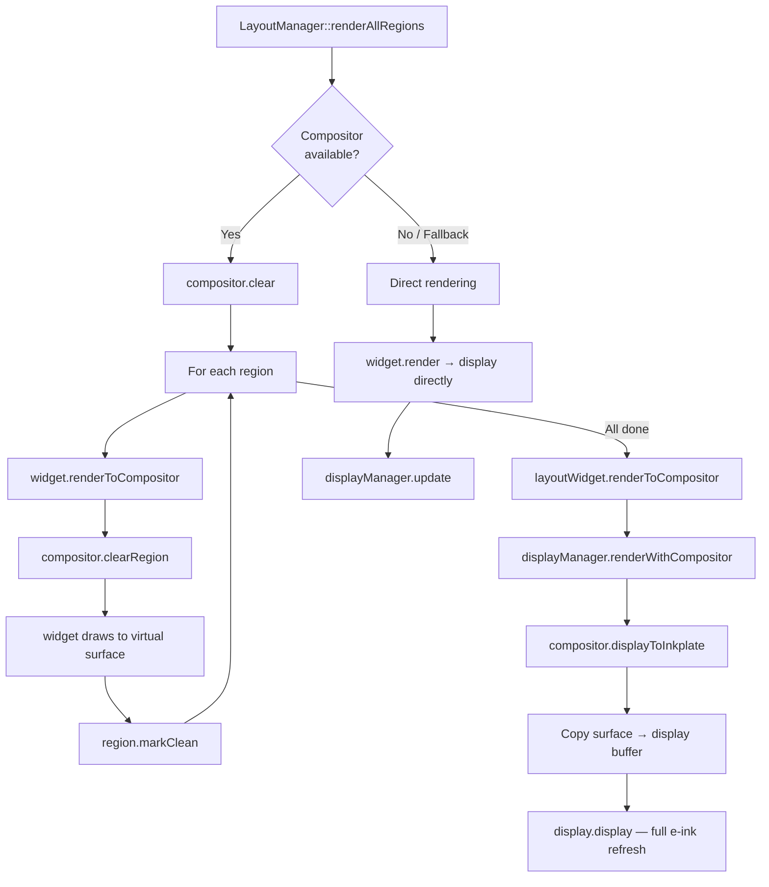
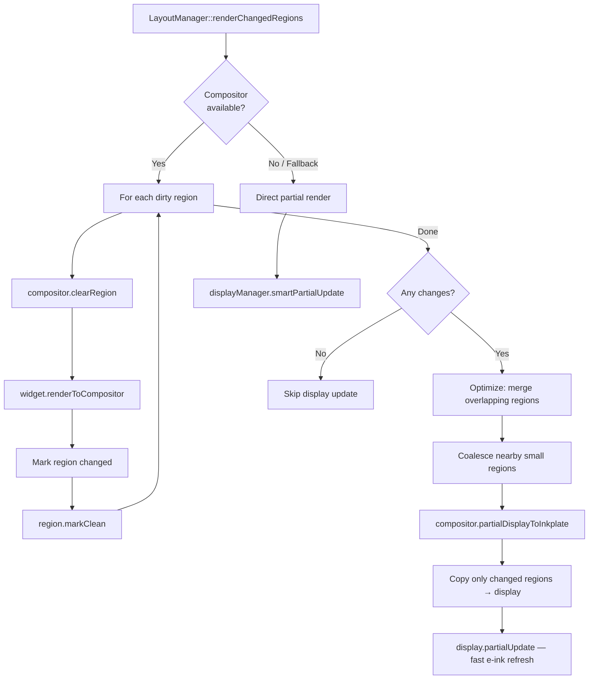
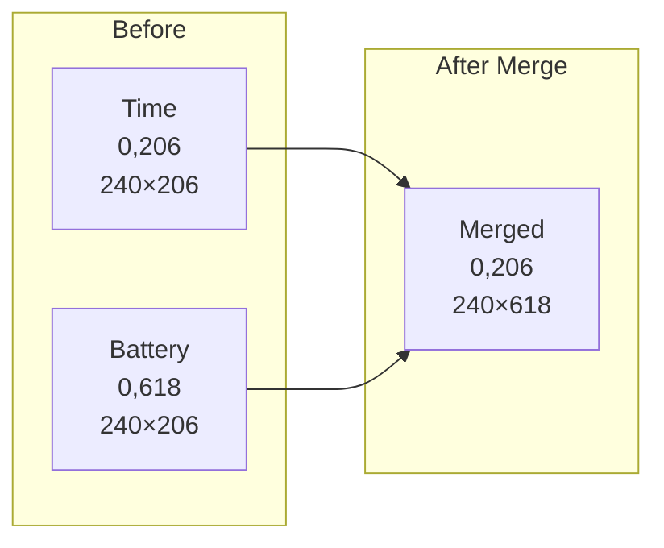
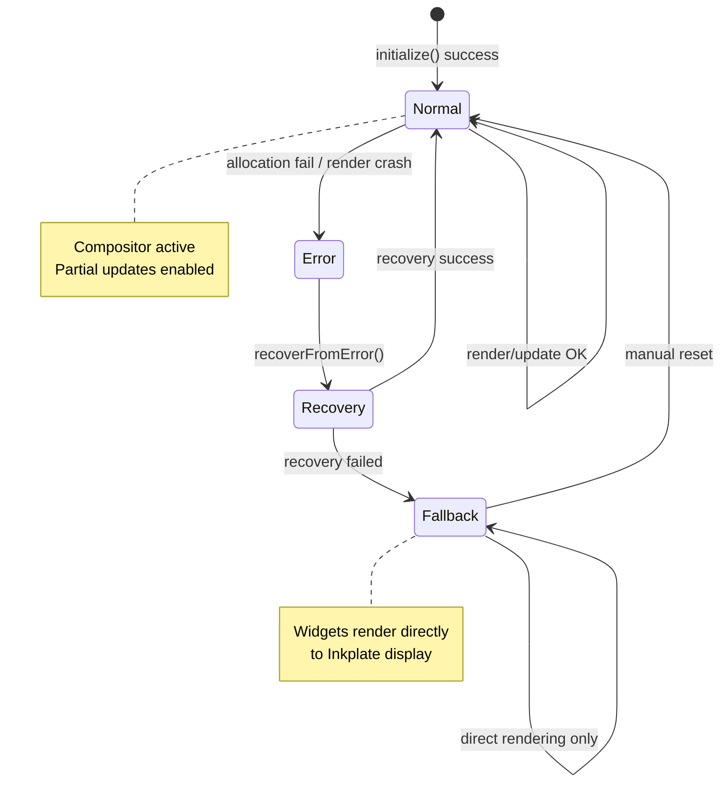

# Compositor Architecture

The Compositor is a virtual framebuffer that sits between widgets and the Inkplate e-ink display. Instead of widgets drawing directly to the hardware, they render to an in-memory surface. The compositor then decides how to push those pixels to the display — full refresh or partial update — minimizing costly e-ink refreshes.

## Why a Compositor?

E-ink displays are slow to refresh (~1-2s for full, ~0.3s for partial). Without a compositor, every widget update triggers a full display refresh. The compositor batches changes and uses partial updates where possible, reducing flicker and power consumption.

## System Overview



## Initialization Sequence

PSRAM must be available before the compositor allocates its buffers. The Inkplate library initializes PSRAM inside `display.begin()`, so compositor init is deferred until after that call.



## Rendering Pipeline

### Full Render (initial boot, button wake)



### Partial Render (changed regions only)



## Memory Layout

```
PSRAM Allocation (~1MB total):
┌─────────────────────────────────────────┐
│  Virtual Surface Buffer                 │
│  1200 × 825 × 1 byte = 990,000 bytes   │
│  (8-bit grayscale per pixel)            │
├─────────────────────────────────────────┤
│  Dirty Region Tracking                  │
│  1200 × 825 × 1 bool = 990,000 bytes   │
│  (per-pixel dirty flag)                 │
└─────────────────────────────────────────┘

Internal SRAM (small allocations):
┌─────────────────────────────────────────┐
│  changedAreas vector (LayoutRegions)    │
│  regionHistory vector (update stats)    │
│  UpdateMetrics struct                   │
└─────────────────────────────────────────┘
```

## Region Merge Optimization

When multiple small regions change, the compositor merges them to reduce the number of partial updates. This avoids the overhead of many tiny e-ink refreshes.



Merge decisions are based on:
- Distance between regions (configurable threshold)
- Merge efficiency ratio (merged area vs sum of individual areas)
- Region update frequency history

## Error Handling & Fallback



When the compositor encounters an error (memory pressure, render failure), it attempts recovery. If recovery fails, it enters fallback mode where widgets render directly to the display hardware — the same behavior as running without a compositor.

## Performance Metrics

The compositor tracks update performance for self-tuning:

| Metric | Purpose |
|---|---|
| `averageUpdateTime` | Decides full vs partial refresh |
| `averagePixelsPerUpdate` | Tunes merge distance threshold |
| `regionHistory` | Tracks per-region update frequency |
| `updateCount` | Total updates since last reset |

## Configuration

Tunable via code (no config.json exposure yet):

```cpp
compositor->setMaxRegionMergeDistance(50);        // px gap to still merge
compositor->setMinRegionSizeForPartialUpdate(100); // min px² for partial
compositor->setUpdateFrequencyThreshold(5000);     // ms between updates
compositor->setRegionMergeEfficiencyThreshold(0.7); // merge if >70% efficient
```
